<div align="center">



<br />

<a href="https://readme-typing-svg.demolab.com">
  
</a>

<br />

[](https://www.python.org/)
[](https://fastapi.tiangolo.com/)
[](https://react.dev/)
[](https://sumo.dlr.de/)
[](#-feature-status)

<br />

<sub>INTELLIGENCE · TRUST · ACCOUNTABILITY</sub>

</div>

A SUMO-based V2X simulation with AI misbehaviour detection, dynamic trust and reputation management, a permissioned blockchain for trust records and evidence, and a real-time Security Operations Center (SOC) dashboard.

## Pipeline


```

SUMO (TraCI) ──► V2X messages (CAM / DENM, signed) ──► attack injection (live, per vehicle)

    ──► radio channel (range, loss, latency, RSU localization)

    ──► misbehaviour detection (rule detectors + multi-class XGBoost / RandomForest)

    ──► received-message history + neighbour reports ──► reputation consensus

    ──► dynamic trust engine ──► smart contract (report / evidence / blacklist / rehabilitate)

    ──► PoA blockchain (RSU validators) ──► FastAPI + WebSocket ──► React dashboard

```


Everything shown in the dashboard is computed by this pipeline; there is no mock data.

If SUMO cannot be started, a simple grid traffic model is used instead (`mock_mode: true` in `/api/health`).


## Quick start


```bash

pip install -r requirements.txt            # includes traci / sumolib; SUMO itself must be installed

python run_demo.py                        # terminal demo (trains the detector first if needed)

python -m ai.train_detector                # optional: (re)train the detector, ~3 min, writes ai/models/

uvicorn backend.api:app --port 8000        # run from the repository root

cd dashboard && npm install && npm run dev # http://localhost:5173

```


`SUMO_BINARY=sumo-gui` opens the SUMO GUI alongside the dashboard. `V2X_MOCK_TRAFFIC=1` forces the

built-in traffic model (used by the tests).


### Demo: emergency vehicle spoofing


1. Open **Control Center**. Tick *Emergency Vehicle Spoofing*, pick a vehicle (or leave it random) and click **LAUNCH ATTACK**,

   or load *Scenario 4 → Emergency Vehicle Spoofing*.

2. A car starts claiming to be an ambulance and broadcasts emergency DENMs. Neighbours and RSUs receive them.

3. The detector flags the type mismatch (registered `car`, claimed `ambulance`) with ~97-99% probability. Trust drops

   (≈ 92 → 70 → 40 → 10 within a few seconds), the smart contract records the misbehaviour report and the evidence hash,

   blacklists the vehicle and revokes its certificate.

4. A 🚨 toast appears. The **Before / After** panel shows trust, status, detection latency and on-chain records.

5. Click any nearby vehicle and open **Messages Received** to see the spoofed messages with sender, distance,

   sender trust, AI confidence, classification and blockchain TX. Evidence can be verified (and tampering simulated)

   against the chain on the **Attacks** tab or in the **Blockchain** explorer.


## Feature status


| Area | Implemented |

|---|---|

| SUMO | 4×4 grid, 2 lanes, traffic lights, random routes, lane changing, dynamic entry/exit, 9 vehicle types (car, SUV, taxi, bus, truck, motorcycle, ambulance, fire truck, police) |

| V2X | CAM beacons (1 Hz), DENMs (emergency approach, congestion, lane change, accident/hazard), pedestrian VAMs; V2V (300 m), V2I (500 m), V2P (80 m) with distance-based loss and latency; RSU warnings to vehicles (I2V); V2N relay of reports to the ledger |

| Attacks | emergency spoofing, false position / speed / acceleration / heading, GPS spoofing, fake accident, flooding, replay, Sybil, message injection, multi-vehicle collusion (fake corroboration + bad-mouthing) |

| Detection | 13 rule detectors with expected-vs-observed evidence + multi-class XGBoost/RandomForest (14 classes) trained on simulator data; Normal / Suspicious / Malicious, attack type, probability, confidence |

| Trust | dynamic score `S·(α·AI + β·consensus + γ·history + δ·ledger)`, trust-weighted neighbour reports, blacklisting, probation-based rehabilitation, history with reasons |

| Identity & privacy | CA enrollment with registered type, rotating ECDSA P-256 pseudonym certificates, signed messages, CRL revocation on blacklist, privacy view (pseudonyms + 50 m location coarsening) |

| Blockchain | permissioned PoA (round-robin RSUs, ECDSA-signed blocks and txs), registration / report / trust / evidence / blacklist / rehabilitation txs, evidence hash verification, centralized-ledger baseline |

| Scenarios | normal, high traffic, emergency vehicles, emergency spoofing, multiple attackers, Sybil, replay, mixed |

| Performance | V2X latency (p50/p95, end-to-end), PDR, loss, throughput, security overhead; blockchain tx latency, TPS, consensus time, storage, replication overhead; AI inference time, detection latency, isolation time, CPU, memory |

| Replay | every run is recorded (`data/runs/`) and can be replayed with a timeline scrubber |

| Experiments | headless runs of the live pipeline: 9 configs, baseline comparison, trust ablation, blockchain-vs-centralized tamper test |

| Dashboard | live map (vehicles, pedestrians, RSUs), vehicle page with 8 tabs, received-message history with filters, alerts/toasts, control center, communication graph, AI metrics, trust management, blockchain explorer, performance, replay, experiments |


## Key API endpoints


| Endpoint | Purpose |

|---|---|

| `GET /api/vehicles/{id}` | full vehicle detail (type vs claimed type, trust components, certificate, counts) |

| `GET /api/vehicles/{id}/messages/received?filter=&sender=&type=&from=&to=` | received message history (`filter`: all, valid, suspicious, malicious, emergency) |

| `GET /api/vehicles/{id}/messages/sent`, `/trust/history`, `/attacks`, `/blockchain` | per-vehicle tabs |

| `POST /api/attacks/launch {attack_type, vehicle_id?}`, `POST /api/attacks/stop`, `GET /api/attacks/{id}/comparison` | attack control and before/after |

| `POST /api/simulation/{start,pause,resume,stop,restart}`, `POST /api/simulation/speed {factor}` | simulation control |

| `GET /api/scenarios`, `POST /api/scenario/load {scenario_id}` | scenario management |

| `GET /api/evidence/{attack_id}[?tamper=true]` | evidence record + on-chain hash verification |

| `GET /api/stats`, `/api/ai/metrics`, `/api/trust/overview`, `/api/graph`, `/api/performance` | analytics |

| `GET /api/runs`, `/api/runs/{id}/frames` | replay |

| `POST /api/experiment/start`, `GET /api/experiments/results` | experiments |

| `GET /api/blockchain/{status,blocks,blocks/{i},transactions,transactions/{tx},validate}` | explorer |

| `WS /ws/telemetry` | `telemetry` (10 Hz) plus `alert`, `block`, `trust_change` events |


## Tests


```bash

python -m pytest            # the live-pipeline tests use the mock traffic model (no SUMO needed)

```


## Project structure


```

ai/           detector (rules + model), feature extraction, training

backend/      FastAPI app, orchestrator (pipeline), evidence store, database

blockchain/   blocks, transactions, PoA chain, smart contracts

simulation/   SUMO integration, road network + vehicle types, attacks, scenarios

trust/        dynamic trust engine, reputation / report aggregation, consensus

v2x/          message factory, identity registry, radio channel, legacy message classes

dashboard/    React + Vite + Tailwind dashboard

experiments/  headless experiment runner, configs, baselines, ablation

docs/         project report, architecture, detection, blockchain & identity, experiments, API reference

```
