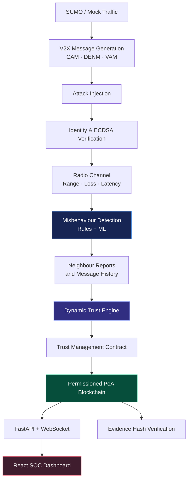

<div align="center">

# 🛡️ V2X GUARDIAN

### AI-Powered Misbehaviour Detection · Dynamic Trust · Blockchain Accountability

**A simulation-driven security framework for connected vehicles.**

Protecting Vehicle-to-Everything (V2X) communication by detecting malicious behaviour, adapting vehicle trust, and preserving verifiable evidence on a permissioned blockchain.

<br />

[](https://www.python.org/)
[](https://fastapi.tiangolo.com/)
[](https://react.dev/)
[](#-system-architecture)
[](#-project-status)

<br />

[Explore the code](https://github.com/YashK-2006/V2X---Guardian) · [Report an issue](https://github.com/YashK-2006/V2X---Guardian/issues)

</div>

---

## The idea

Connected vehicles continuously exchange status, hazard, and emergency messages. A forged emergency alert or coordinated false report can undermine road safety and network reliability.

**V2X Guardian** models this problem end to end. It simulates traffic and V2X communications, detects suspicious messages, fuses detector output with reputation signals, adjusts trust, and records security events and evidence hashes on a permissioned blockchain. A live dashboard exposes the pipeline for inspection and experimentation.

> **Design principle:** detection, trust decisions, and ledger events are driven by the running simulation pipeline—not a dashboard filled with hard-coded demo values.

## At a glance

<table>
<tr>
<td width="50%" valign="top">

### 🧠 AI security
- Rule-based misbehaviour checks
- Multi-class XGBoost / Random Forest detector
- Classification, confidence, and attack-type outputs
- Detection and isolation performance metrics

</td>
<td width="50%" valign="top">

### 🚘 V2X simulation
- SUMO + TraCI integration
- CAM, DENM, and pedestrian VAM messages
- V2V, V2I, and V2P communication modelling
- Distance-dependent packet loss and latency

</td>
</tr>
<tr>
<td width="50%" valign="top">

### 🧭 Dynamic trust
- AI, consensus, history, and ledger signals
- Neighbour-report aggregation
- Blacklisting and probation-based rehabilitation
- Trust history with decision reasons

</td>
<td width="50%" valign="top">

### ⛓️ Verifiable accountability
- Permissioned Proof-of-Authority ledger
- ECDSA-signed blocks and transactions
- On-chain evidence hashes
- Report, blacklist, and rehabilitation records

</td>
</tr>
</table>

## System architecture

The data path connects traffic simulation to security decisions and a live operational view.



### Processing flow

1. **Simulate:** vehicles and pedestrians generate messages in a SUMO-driven road network, with a mock traffic mode available for supported test runs.
2. **Challenge:** configurable attacks falsify, replay, flood, forge, or coordinate malicious messages.
3. **Assess:** identity checks, rule detectors, and the trained classifier evaluate received messages.
4. **Build consensus:** receiver history and trust-weighted neighbour reports add context to detector output.
5. **Respond:** the trust engine updates scores and supports blacklisting and rehabilitation.
6. **Audit:** the ledger records security actions and evidence hashes; the dashboard streams telemetry and events.

For implementation details, see [Architecture](docs/architecture.md).

## Demonstration scenario: emergency vehicle spoofing

A vehicle registered as a regular car begins claiming to be an ambulance and transmitting emergency messages.

| Stage | What to inspect |
|---|---|
| Attack launch | Start **Emergency Vehicle Spoofing** from the Control Center or load the matching scenario |
| Detection | Observe the registered-versus-claimed type mismatch and the detector's classification and confidence |
| Trust response | Follow the vehicle's trust history and status changes |
| Accountability | Inspect the report, evidence hash, transaction, and blacklist action in the blockchain explorer |
| Verification | Use the evidence view to check the recorded hash and explore the tamper-test path |
| Context | Open the vehicle's received-message history to inspect sender, distance, trust, and classification |

The values and timing depend on the running simulation and configuration.

## Technology stack

| Layer | Technologies |
|---|---|
| Traffic simulation | SUMO, TraCI, Python |
| V2X messaging | CAM, DENM, VAM; simulated V2V / V2I / V2P links |
| Identity and cryptography | ECDSA P-256, pseudonym certificates, certificate revocation |
| AI detection | scikit-learn, XGBoost, feature extraction, rule-based checks |
| Trust and consensus | Dynamic trust engine, trust-weighted reputation aggregation |
| Ledger | Python permissioned Proof-of-Authority blockchain, smart-contract-style trust rules |
| Backend | FastAPI, REST, WebSocket, SQLite |
| Dashboard | React, Vite, Tailwind CSS |
| Experiments | Headless runs, baselines, trust ablation, ledger comparison |
| Testing | pytest |

## Quick start

### Prerequisites

- Python and pip
- Node.js and npm for the dashboard
- SUMO installed and configured if you want the full traffic simulator

### 1. Set up Python

From the repository root:

```bash
python -m venv .venv
source .venv/bin/activate
python -m pip install --upgrade pip
pip install -r requirements.txt
```

On Windows PowerShell, activate the virtual environment with:

```powershell
.venv\Scripts\Activate.ps1
```

### 2. Run the demo

```bash
python run_demo.py
```

### 3. Start the API

In a separate terminal, from the repository root:

```bash
uvicorn backend.api:app --reload --port 8000
```

### 4. Start the dashboard

In another terminal:

```bash
cd dashboard
npm install
npm run dev
```

Open the Vite URL printed in the terminal (usually [http://localhost:5173](http://localhost:5173)).

### Useful configuration

```bash
# Force the built-in traffic model, useful for tests and environments without SUMO
V2X_MOCK_TRAFFIC=1

# On supported installations, open the SUMO GUI
SUMO_BINARY=sumo-gui
```

These are environment-variable examples; set them in the shell before starting the process. Check `/api/health` for the active simulation mode.

## Capabilities

| Area | Implemented scope |
|---|---|
| Simulation | 4×4 grid network, traffic lights, routes, vehicle types, vehicle entry/exit, configurable scenarios |
| Message types | CAM beacons, DENM hazard/emergency events, pedestrian VAMs |
| Communication | V2V (300 m), V2I (500 m), V2P (80 m) range models with distance-dependent loss and latency |
| Attack scenarios | Emergency spoofing, position/speed/heading falsification, GPS spoofing, false accidents, flooding, replay, Sybil, injection, and coordinated reports |
| Detection | Rule detectors plus multi-class model; classification, attack type, confidence and metrics |
| Trust response | AI + consensus + history + ledger inputs, trust history, blacklist and rehabilitation workflow |
| Identity | Enrollment, pseudonym certificates, message signatures and certificate revocation list |
| Blockchain | RSU-validator PoA, transactions for reports / evidence / trust / blacklist / rehabilitation, hash verification |
| Observability | Live map, communication graph, alerts, AI metrics, trust overview, blockchain explorer and performance view |
| Replay & experiments | Run recording and replay timeline, headless experiments, baseline and ablation workflows |

Exact behaviour and supported scenarios are defined by the current code and configuration.

## API surface

The backend exposes REST endpoints and a WebSocket telemetry stream. Examples of documented endpoint families:

| Endpoint | Purpose |
|---|---|
| `GET /api/vehicles/{id}` | Vehicle detail, trust components, certificate and counters |
| `GET /api/vehicles/{id}/messages/received` | Received-message history with filters |
| `POST /api/attacks/launch` · `POST /api/attacks/stop` | Attack control |
| `POST /api/simulation/{start,pause,resume,stop,restart}` | Simulation lifecycle controls |
| `GET /api/evidence/{attack_id}` | Evidence record and on-chain hash verification |
| `GET /api/stats` · `GET /api/ai/metrics` · `GET /api/trust/overview` | Operational metrics |
| `GET /api/blockchain/blocks` · `GET /api/blockchain/transactions` · `GET /api/blockchain/validate` | Ledger inspection and validation |
| `WS /ws/telemetry` | Live telemetry, alerts, new blocks and trust changes |

Use the API source and interactive API documentation exposed by the running FastAPI app for the authoritative request schemas.

## Testing

```bash
python -m pytest
```

The test configuration is designed to use the mock traffic model where appropriate, so supported tests can run without a local SUMO installation.

## Repository map

```text
ai/           Rule detectors, ML detector, features, training
backend/      FastAPI endpoints, orchestrator, evidence and persistence
blockchain/   Blocks, transactions, PoA chain and trust contract
dashboard/    React + Vite + Tailwind security dashboard
data/         Local databases and run data (runtime-generated)
docs/         Architecture and technical documentation
experiments/  Headless experiment runner, baselines and ablations
simulation/   SUMO integration, road network, vehicles, attacks and scenarios
tests/        Automated test suite
trust/        Dynamic trust, reputation and report aggregation
v2x/          Message factory, identity and radio-channel model
```

## Project status

V2X Guardian is an engineering and simulation project. The ledger and network behaviours are implemented in this codebase for experimentation; they should not be interpreted as a production-ready vehicular safety system or as a deployed public blockchain.

## Contributing

Issues and focused pull requests are welcome. When reporting a bug, include the operating system, Python and Node versions, the command used, relevant logs, and whether SUMO or mock mode was active. Do not commit secrets, virtual environments, local databases, generated experiment runs, or large downloaded installers.

## License

No license file is currently declared in this repository. Until a license is added, assume the project is **not licensed for reuse or redistribution** beyond rights granted by applicable law.

---

<div align="center">

**V2X Guardian** · Building more accountable connected-vehicle systems

<sub>Research prototype · Simulation-first · AI-assisted security</sub>

</div>
